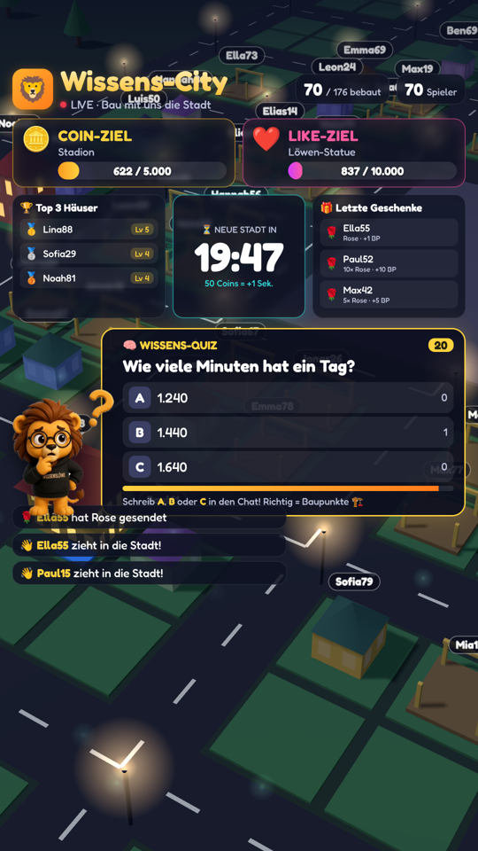

# 🦁 Wissens-City LIVE

Interaktives TikTok-LIVE-Spiel: Zuschauer bauen gemeinsam eine 3D-Stadt – mit Geschenken, Likes, Folgen, Teilen und einem Wissens-Quiz.

## Features
- 🏡 Jeder startet mit einem **Bauernhaus (Level 1)**, das immer weiter ausgebaut wird – bis zum Diamant-Turm und Weltwunder; die Kamera zoomt auf jedes Haus, das gerade wächst
- ❤️ **Alle 5.000 Likes** ein neues Bauwerk (Riesenrad, Bushaltestelle, Lampen, Feuerwerk …), **alle 20.000 Likes** ein ⚡ Zeit-Generator (+2 Sek. alle 10 Sek.)
- 🔊 Gesprochenes **„Danke fürs Folgen / Teilen“**
- 🧠 **Wissens-Quiz** mit über 200 Fragen ohne Wiederholung (A/B/C im Chat, +10 Baupunkte pro richtiger Antwort)
- 🎉 **Happy Hour** (x2 Baupunkte) alle 2 Minuten und bei großen Geschenken
- 👑 Top-3-Ansagen, ❤️ Danke fürs Folgen, 🔁 Teilen-Bonus, 🌌 Mega-Effekte bei großen Geschenken
- 🔊 **Gesprochenes Dankeschön** ab 2 Coins
- ⏳ Runden-Timer mit Zeitbonus (Coins, Level, Quiz) und kompletter Neustart der Stadt

## Schnellstart
1. [Node.js](https://nodejs.org) (LTS) installieren
2. In `config.json` den TikTok-Namen eintragen
3. `TESTMODUS.bat` zum Ausprobieren, `START.bat` zum Live-Gehen

👉 Ausführliche Anleitung: [ANLEITUNG.md](ANLEITUNG.md)
